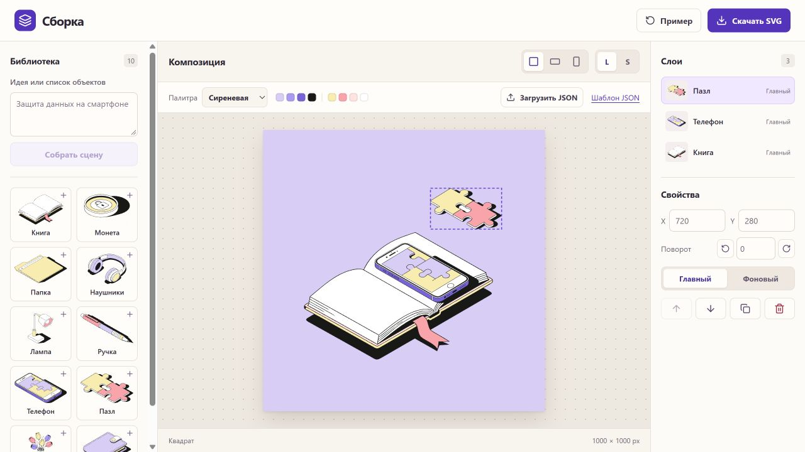
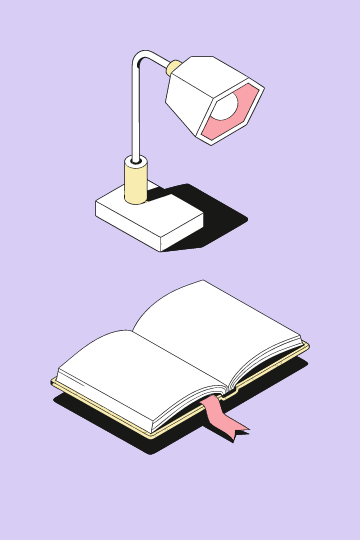
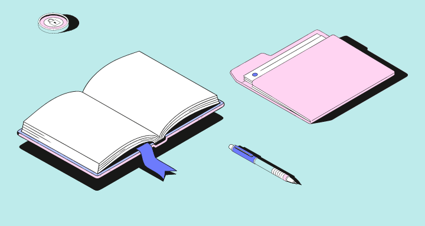

# Конструктор SVG-иллюстраций

Веб-редактор собирает сцены из исходных SVG по метафоре или списку предметов. Композицию можно доработать вручную, перекрасить и скачать для дальнейшего редактирования.



## Быстрый старт

Установите Node.js 24 и `uv`. Версия Python задана в `.python-version`. Для автоматической сборки скопируйте `.env.example` в `.env` (`Copy-Item .env.example .env` в PowerShell или `cp .env.example .env` в Bash) и укажите ключ модели. Готовый пример и ручной редактор доступны без ключа.

| Переменная | Значение |
| --- | --- |
| `LLM_API_KEY` | Ключ выбранного провайдера или прокси. |
| `LLM_BASE_URL` | Базовый URL OpenAI-совместимого API, обычно с `/v1`. Значение по умолчанию — `https://api.openai.com/v1`. |
| `LLM_MODEL` | ID модели у провайдера или алиас модели в прокси. |
| `LLM_REASONING_EFFORT` | Опционально. Например, `medium` или `high`, если модель поддерживает `reasoning_effort`. Пустое значение оставляет настройку провайдеру. |

Приложение использует Python SDK `openai`. Подключаемый API должен поддерживать `POST /chat/completions`, изображения на входе и Structured Outputs через `response_format: json_schema`. Для уже запущенного локального LiteLLM укажите его URL, например `http://127.0.0.1:4000/v1`, и алиас из его конфигурации. `.env` исключён из Git.

Из корня проекта соберите интерфейс и запустите сервис.

```powershell
npm --prefix frontend ci
npm --prefix frontend run build
uv run --locked uvicorn main:app
```

На [localhost:8000](http://localhost:8000) введите заголовок, метафору или список объектов в поле «Идея или список объектов» и нажмите «Собрать сцену». Объекты также можно добавлять из библиотеки, перемещать по холсту, дублировать и переставлять в панели слоёв. В свойствах есть выбор роли, координаты и поворот с шагом 15°. Выбранный слой удаляется клавишей `Delete`, когда фокус находится на холсте или в панели слоёв.

### Встроенный LiteLLM для Gemini

Чтобы включить LiteLLM в том же процессе FastAPI, задайте от одного до четырёх ключей Gemini в `LITELLM_API_KEY_1`–`LITELLM_API_KEY_4`. Локально используйте `.env`, на Render — **Environment Variables**. Уже настроенные команды сборки и запуска подходят. В этом режиме запросы идут напрямую в Gemini через Router, а `LLM_API_KEY`, `LLM_BASE_URL` и `LLM_MODEL` относятся к обычному OpenAI-совместимому режиму.

По умолчанию основная модель — `gemini-3.5-flash-lite`, резервная — `gemini-3.1-flash-lite`. Их можно поменять через `LITELLM_MODEL` и `LITELLM_FALLBACK_MODEL`. Пустая переменная `LITELLM_FALLBACK_MODEL` отключает резерв. Высокий уровень рассуждения задаётся через `LLM_REASONING_EFFORT=high`. При временных сбоях Router делает до двух повторов в группе модели и затем может переключиться на резервную. Ключи одного проекта Google используют общую квоту.

Квадратный, горизонтальный и вертикальный холсты для `L` имеют размеры `1000 × 1000`, `1200 × 640` и `800 × 1200`. В режиме `S` размеры вдвое меньше, а редактор использует отдельные упрощённые SVG. При смене формата редактор вписывает сцену одним масштабом, сохраняя взаимное расположение, порядок и поворот слоёв.

Нажмите «Скачать SVG» и перетащите файл на холст открытого документа Figma Design. Экспорт содержит отдельную SVG-группу на каждый объект с исходными векторными контурами.

### Палитры

В панели над холстом доступны сиреневая, персиковая и бирюзовая схемы из исходных SVG. Выбранная схема применяется к холсту, миниатюрам, главным и фоновым вариантам объектов. Экспорт использует ту же перекраску.

Кнопка «Загрузить JSON» принимает свою схему. Рядом в редакторе можно скачать [шаблон палитры](frontend/public/palette-template.json). Укажите по четыре HEX-цвета в каждом списке. Позиции соответствуют образцам Figma сверху вниз. В `background` первый цвет задаёт холст, следующие два — его оттенки на объектах, последний — контуры и тени. В `objects` три цвета предметов идут перед светлой заливкой. `name` — подпись в списке, её можно опустить.

```json
{
  "name": "Моя палитра",
  "background": ["#E9EDE5", "#C6D4C0", "#849A82", "#202820"],
  "objects": ["#F2CC8F", "#C87862", "#EDC7AF", "#FFFAF3"]
}
```

Для разработки интерфейса запустите `npm --prefix frontend run dev` параллельно с FastAPI на порту `8000`. Vite перенаправит `/api` в FastAPI.

## API

Документация API доступна по адресу [localhost:8000/docs](http://localhost:8000/docs).

- `GET /api/catalog` отдаёт логические объекты с короткими `id`, общим `description`, `anchors` и вариантами. Каждый вариант содержит `key`, `size`, `role`, `url`, `width`, `height` и `view_box`.
- `GET /api/assets/L/main/phone.svg` возвращает исходный SVG цветного телефона размера L.
- `POST /api/compose` принимает `prompt`, `size`, `width` и `height`. Он возвращает общий `scale` и упорядоченный список `layers` с ID объекта, ролью и нормализованными координатами.
- В сцене может быть несколько экземпляров одного объекта. Если запрошенного объекта или подходящих вариантов нет, `/api/compose` возвращает `422` с пояснением, а редактор сохраняет текущую сцену.

## Архитектура

1. **Хранение и извлечение.** В `raw_assets` лежат 40 исходных SVG. FastAPI сканирует папки, читает каждый `viewBox` и группирует варианты по ID. Описания, размеры и `anchors` хранятся в `catalog.json`. Хеш эталона `L/main` позволяет переиспользовать анализ Vision при следующих запусках.
2. **Генерация.** Первый запрос получает каталог и возвращает ID по одному на каждый экземпляр. Во втором запросе модель получает экземпляры, размеры, точки привязки и PNG-превью исходников. Она проверяет зазоры между отдельными предметами и опору для задуманных наложений, затем возвращает координаты, роли и порядок слоёв. Pydantic проверяет ответ. При временном сбое шлюз делает до одного повтора конкретного запроса. Сервер при необходимости вписывает всю сцену в холст общим масштабом и сдвигом.
3. **Переиспользование SVG.** React разбирает SVG как XML, оставляет поддерживаемые векторные элементы и атрибуты и переписывает внутренние `id`, `href` и `url(#…)` для каждого экземпляра. Это позволяет дублировать объекты без конфликтов. Одна функция готовит разметку для холста и скачиваемого SVG. Перекраска заменяет значения цветов по позициям эталонной палитры и сохраняет контуры. Общий масштаб, сдвиг и поворот применяются к группе целиком.

## AI-инструменты

- **Codex** помогал со структурой проекта, кодом редактора и API, проверками и документацией.
- **Gemini 3.5 Flash-Lite** через LiteLLM использовалась для анализа SVG, подбора объектов и генерации раскладок ниже. Векторные элементы берутся из `raw_assets`.

## Примеры запросов и результатов

### 1. Абстрактный запрос

> Вечерний ритуал перед сном.

Модель выбрала книгу и лампу. Вертикальный холст `S`, 400 × 600, сиреневая палитра. [SVG](examples/evening-reading.svg)



### 2. Тематический запрос

> Рабочий стол студента-экономиста.

Горизонтальный холст `L`, 1200 × 640, бирюзовая палитра. [SVG](examples/economics-student-desk.svg)



### 3. Точное размещение и фоновые объекты

> Книга, на левой странице ручка, на правой монетка. Слева на фоне лампа, справа на фоне ваза.

Квадратный холст `L`, 1000 × 1000, персиковая палитра. [SVG](examples/book-page-layout.svg)


### 4. Предмет вне каталога

> Собери композицию из книги и скейтборда.

Сервис вернул `HTTP 422` и сохранил текущий холст.

> В каталоге отсутствуют запрошенные объекты — «скейтборд».

Кнопка «Пример» открывает [стартовую сцену с книгой, телефоном и пазлом](examples/book-phone-puzzle.svg).

## Проверки

```powershell
npm --prefix frontend test
uv run --locked python -m unittest discover -s tests
```

Тесты покрывают смену формата, палитры, параметры провайдера, повтор сбойного запроса, экземпляры одного объекта и ответ при отсутствии подходящего предмета.

## Как пополняется каталог

Добавьте SVG с `viewBox` в нужную папку `raw_assets/{L,S}/{main,bg}` и перезапустите API. Варианты одного объекта должны иметь общее имя файла. Можно начать с одного варианта и добавить остальные позже.

В `catalog.json` ключом служит короткий ID объекта, например `book`. Запись содержит одно описание, именованные `anchors` и доступные варианты `L_main`, `L_bg`, `S_main` и `S_bg`. Для каждого варианта `file` — путь относительно `raw_assets`, а `width` и `height` берутся из его `viewBox`. В промпт семантического подбора достаточно передавать ID и описание.

При запуске API сверяет варианты с `raw_assets` и использует `source_sha256` для проверки описания и точек по эталону `L/main`. Только новый или изменённый эталон отправляется в Vision. Если эталона ещё нет, варианты уже доступны, а `description` и `anchors` заполнятся после его обработки.

Точки хранятся в диапазоне от 0 до 1 относительно всего `viewBox`. Для выбранного варианта `[minX, minY, width, height]` пересчёт в координаты SVG выглядит как `(minX + x * width, minY + y * height)`. Такая проекция сохраняет относительную позицию. Если в другом варианте перемещена или упрощена сама деталь, её положение нужно сверять отдельно.

Пересобрать каталог с нуля можно командой `uv run -m asset_catalog --rebuild`. Запуск той же команды без `--rebuild` обрабатывает только пропущенные или изменённые эталоны.
